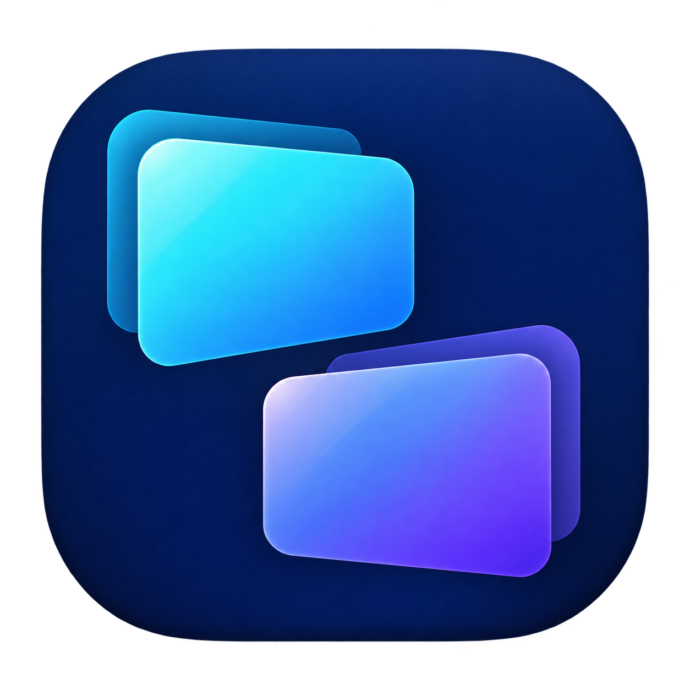

# BetterVirtualDesktop



Windows 11에서 **모니터마다 가상 데스크톱을 독립적으로 전환**하는 앱입니다. 한 모니터의 작업 공간을 바꿔도 다른 모니터의 창은 그대로 유지됩니다.

## 핵심 기능

- **모니터별 데스크톱:** 각 디스플레이에서 데스크톱 생성·전환·이름 변경·삭제.
- **작업 보기 오버레이:** 모든 모니터에 데스크톱 목록과 창 미리보기 표시.
- **창 이동:** 드래그·우클릭·단축키로 다른 데스크톱·모니터에 이동. 현재 데스크톱과 오버레이 미리보기를 유지하며, 새 데스크톱 카드에 놓아도 자동 전환하지 않음.
- **작업 표시줄에서 전환:** 앱 아이콘이나 창 미리보기로 선택한 창의 데스크톱으로 전환. 같은 앱의 여러 창도 개별적으로 구분하고, 해당 모니터만 전환.
- **상태 안내:** 생성·이동 완료 알림, 선택 카드 강조, 전환한 데스크톱 이름 표시.
- **다국어:** 한국어·영어·중국어 간체/번체·일본어. 언어 선택은 즉시 적용하고 저장.
- **단축키 설정:** 기능별 키 조합 변경·해제, Windows 기본키 프리셋, 설정 저장.
- **자동 실행 선택:** 트레이 메뉴에서 Windows 로그인 시 백그라운드 실행을 켜거나 끄기.
- **창 복구:** 종료 시 숨긴 창을 복원하고, 비정상 종료에 대비한 별도 복구 프로세스 제공.

## 주요 단축키 (초기 설정)

| 동작 | 단축키 |
| --- | --- |
| 모든 모니터의 작업 보기 열기 / 닫기 | `Win + Alt + Tab` |
| 마우스가 있는 모니터의 이전 / 다음 데스크톱 | `Win + Ctrl + ← / →` |
| 데스크톱 생성 후 전환 | `Win + Ctrl + D` |
| 현재 데스크톱 삭제 | `Win + Ctrl + F4` |
| 현재 창을 이전 / 다음 데스크톱으로 이동 | `Win + Ctrl + Shift + ← / →` |
| 모든 창 복구 후 일시 정지 | `Win + Ctrl + Shift + F12` |

작업 보기에서는 `← / →`로 미리 보고, `Enter`로 전환하며, `Esc`로 닫습니다. 초기 설정에서는 `Win + Tab`이 Windows 기본 작업 보기를 엽니다.

작업 보기 상단·관리 창·트레이의 **단축키 설정**에서 키 조합을 변경하거나 해제할 수 있습니다. **Windows 기본키 사용**을 선택하고 저장하면 `Win + Tab`으로 이 앱의 작업 보기를 엽니다. 저장한 설정은 즉시 적용되고 다음 실행에도 유지됩니다. 중복 조합과 지원하지 않는 시스템 키는 저장 전에 안내합니다.

트레이 메뉴의 **Windows 시작 시 자동 실행**을 켜면 로그인할 때 오버레이를 열지 않고 백그라운드에서 실행합니다. 초기값은 꺼짐입니다. 배포 폴더를 옮긴 경우 새 위치의 앱을 실행해 이 항목을 다시 켜세요. Windows **설정 → 앱 → 시작 프로그램**에서 앱을 끄면 자동 실행이 차단됩니다.

크롬처럼 창이 여러 개인 앱은 작업 표시줄의 창 목록에서 원하는 창을 선택하세요. Windows가 실제로 선택한 창을 따라가므로 다른 창을 임의로 고르지 않습니다. 숨겨진 창의 작업 표시줄 미리보기는 앱에 따라 마지막 화면이나 아이콘으로 표시될 수 있습니다.

## 빌드 및 실행

Windows 11 x64와 .NET 10 SDK가 필요합니다.

```powershell
.\scripts\build.ps1 -Publish
.\artifacts\publish\BetterVirtualDesktop.exe
```

배포 폴더는 .NET 런타임을 포함합니다. 다른 PC에서는 폴더 전체를 복사해 실행하세요. 기존 버전이 실행 중이면 트레이 메뉴의 **종료 · 모든 창 복구**로 종료한 뒤 새 버전을 실행합니다.

```powershell
.\scripts\test.ps1
```

## 개발 환경

- **개발·검증:** Windows 11 x64, 다중 모니터 환경
- **언어·UI:** C#, .NET 10, Windows Forms
- **창 제어·미리보기:** Windows API(Win32), DWM
- **도구:** Codex 데스크톱 앱, PowerShell, .NET CLI — 검증 SDK `10.0.400`
- **AI 활용:** **ChatGPT Astra Ultra**의 도움을 받아 설계·구현·테스트·문서 작업을 진행했습니다. 앱 아이콘은 ImageGen으로 제작했습니다.

## 참고

Windows 기본 가상 데스크톱과 별도로 창의 표시·숨김을 관리합니다. 데스크톱 구성과 창 배정은 실행 중에만 유지되며, 관리자 권한 앱이나 일부 특수 창은 제어가 제한될 수 있습니다.

자세한 동작과 검증 범위는 [구현 문서](docs/architecture.md)를 참고하세요.
